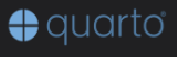
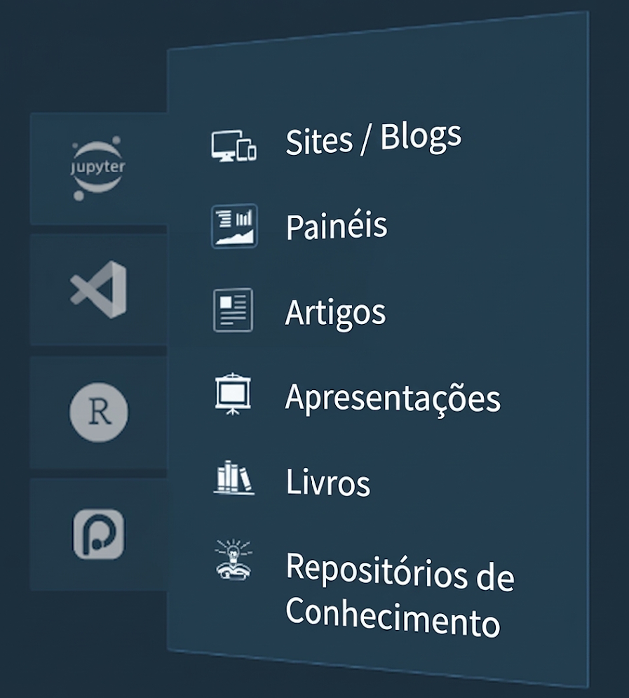
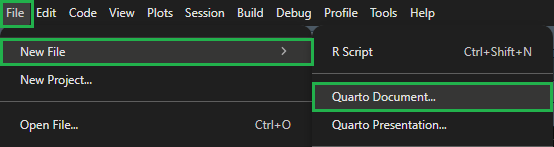
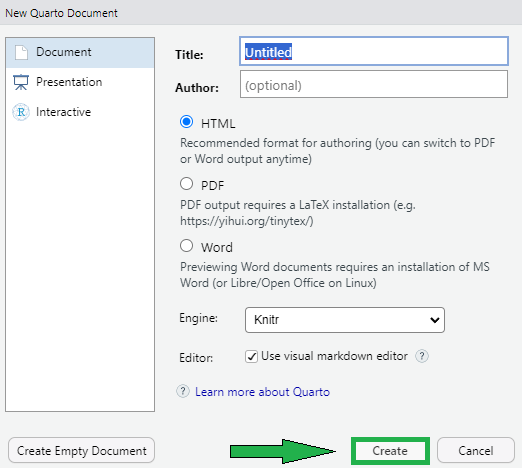
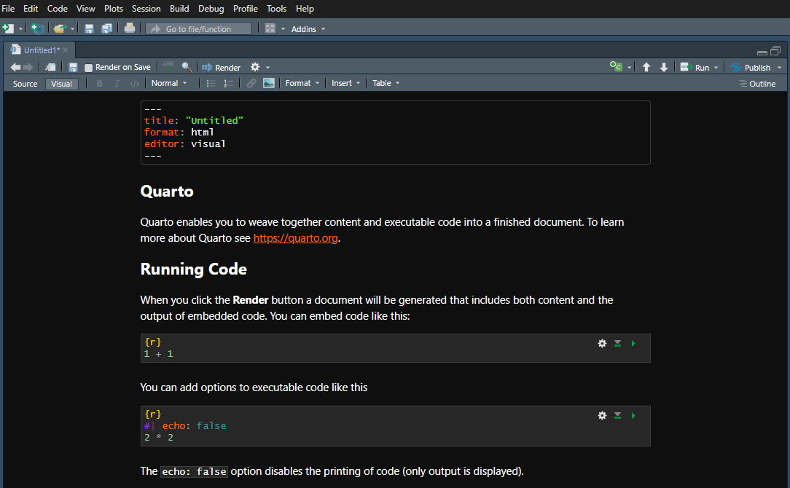
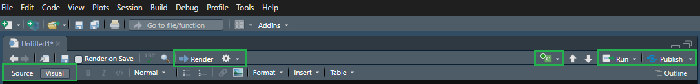
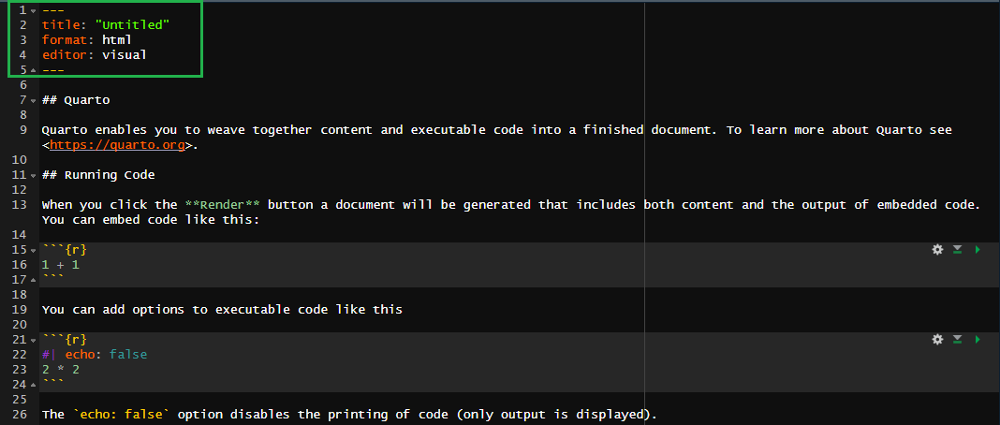
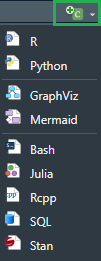

```{=html}
<style>
.sidebar-footer {
  position: fixed;
  bottom: 10px;
  left: 10px;
  font-size: 0.9em;
  color: #555;
}
</style>
```

::: sidebar-footer
<strong>Orientador:</strong> Guilherme Veloso
:::

```{=html}
<style>
/* Container principal - centraliza tudo */
.title-container {
  text-align: center;
  margin: 0 auto 30px auto;
  width: 100%;
  max-width: 900px;
}

/* Título */
h1.title {
  color: #2c3e50;
  text-align: center !important;
  margin-bottom: 10px !important;
  padding-bottom: 10px;
  border-bottom: 2px solid #3498db;
}

/* Autor */
.author {
  display: block;
  text-align: center !important;
  font-style: italic;
  color: #7f8c8d;
  margin-bottom: 5px !important;
}

/* Data */
.date {
  display: block;
  text-align: center !important;
}
</style>
```

```{r , echo=FALSE}
library(knitr)
```
::: {style="text-align: justify;"}

## **O que é o QUARTO**

{fig-align="center" width="49%"}

O **quarto** é uma ferramenta de publicação e tecnica de código aberto, a evolução multilíngue do *markdown* , permitindo que o usuário consiga misturar texto e códigos, buscando **automação e reprodutibilidade**, elimina o trabalho de ter que [copiar, colar, formatação]{.underline}, e demais outros que fazem termos um trabalho a mais desnecessário, que temos ao utilizar mais de uma plataforma pra gerar uma apresentação por exemplo.

Ainda trazendo benefícios por ser um **documento vivo**, permitindo que quaisquer alterações em gráficos, textos, formulas e funções seja facilmente alterado, garantindo que os resultados sejam **reais e auditáveis**, de forma unificada, Pra uma apresentação quantos programas se utiliza? *Excel, Word, powerpoint, ide's*.

No quarto você está juntando tudo isso de forma **otimizada e prática**, talvez você argumente que um *markdown* já faça isso, mas e a quantidade de bibliotecas que são utilizadas pra fazer do seu jeito (`xaringan` , `bookdown`), o quarto é mais atualizado, e quaisquer novidades que estão por vir ainda tendem a aparecer aqui já que a empresa **POSIT** detentora do **QUARTO** dá prioridade a ferramenta mais do que o *Rmarkdown*.

A ferramenta ainda tem mecânicas de exportação, nos permitindo exportar o nosso arquivo em diversos formatos como: **PDF, PPTX, html, doc**, ou até mesmo publicá-lo na internet através de um domínio.

### história do QUARTO

{fig-align="center" width="40%"}

O **Quarto** não surgiu do nada; ele é a evolução direta do *R Markdown*, uma ferramenta que revolucionou a **pesquisa reprodutível** na última década. O *R Markdown* popularizou a ideia de misturar texto narrativo com blocos de código, permitindo gerar relatórios automatizados e eliminando o processo doloroso de [copiar e colar gráficos manualmente]{.underline}. No entanto, todo esse ecossistema estava intrinsecamente amarrado a uma única linguagem: o `R`.

Com a maturação da ciência de dados, os ambientes de trabalho se tornaram **multilíngue**, impulsionados pela adoção massiva de `Python` (*Jupyter*) e `Julia`. A equipe da *RStudio* percebeu que a comunidade precisava de um **sistema de publicação universal**. A dor de criar relatórios dinâmicos não era exclusiva dos usuários de R, e a solução também não deveria ser. Era preciso um sistema que funcionasse [independentemente da linguagem de programação ou da IDE]{.underline} escolhida.

Foi para resolver esse gargalo que a **Posit** (o novo nome da *RStudio*) reconstruiu o motor de publicação do zero, lançando o **Quarto**. Em vez de ser apenas um pacote do R, o Quarto nasceu como um [software de linha de comando independente]{.underline}, construído sobre o `Pandoc`. Ele herdou as melhores ideias do seu antecessor, mas com uma **arquitetura agnóstica**. Hoje, ele entrega o mesmo poder de criação de documentos dinâmicos, artigos e *dashboards* de forma nativa para usuários de `R`, `Python`, `Julia` e `Observable JS`, unificando a forma como a ciência de dados é comunicada.

### Como Instalar o QUARTO

A melhor notícia: você provavelmente **já tem o Quarto instalado**!

-   **Usuários de RStudio:** A partir da versão v2022.07, o RStudio já inclui o Quarto nativamente. Basta abrir o programa e começar a usar.

-   **Outros editores (VS Code, Jupyter, Neovim):** O Quarto funciona como um software independente.

    1.  Acesse [quarto.org](https://quarto.org/docs/get-started/)
    2.  Baixe o instalador para o seu sistema operacional (Windows, Mac ou Linux).
    3.  Siga o passo a passo padrão de instalação.

Para ter certeza de que tudo está funcionando, abra o **Terminal** e digite:

``` r
quarto check
```

## **QUARTO das possibilidades**

{fig-align="center" width="30%"}

- **Relatórios**
- **Apresentações**
- **Dashboards**
- **Websites**
- **Livros**
- **Documentos Interativos**
- **Artigos Científicos e Académicos**

Estas são algumas das possibilidades do que podemos criar no **QUARTO**. O grande motivo para utilizar esta ferramenta para estas situações resume-se a dois conceitos: **reprodutibilidade** e **interação com a programação**.

Imagine que pretende incluir um gráfico no relatório de apresentação para o seu diretor. Em vez de gerar o gráfico no `R`, guardar a imagem, exportar, copiar e colar num ficheiro *Word* para, por fim, gerar um PDF, pode simplesmente utilizar o **QUARTO**. Além de centralizar tudo numa única plataforma, garante a capacidade de reproduzir o trabalho com o mínimo de esforço caso os dados sofram alterações.

*   **Relatórios:** O carro-chefe do Quarto. Permite mesclar texto narrativo com blocos de código executável, gerando documentos em HTML, PDF ou Word onde os gráficos e análises estão sempre sincronizados com os dados mais recentes[cite: 29].
    *   *Exemplo prático:* Criar um relatório mensal de vendas. Se a base de dados comercial for atualizada, o relatório compila automaticamente o novo faturamento e reconstrói os gráficos sem necessidade de ajustes manuais.

*   **Apresentações:** Crie diapositivos dinâmicos (como o formato *Revealjs*) sem sair do seu editor (IDE). É a forma mais segura de apresentar resultados, garantindo que o código por trás de um gráfico crucial corra na perfeição diretamente no ecrã[cite: 29].
    *   *Exemplo prático:* Estruturar os slides para uma reunião corporativa ou uma palestra académica, onde tabelas de resultados e gráficos dinâmicos são processados e exibidos ao vivo.

*   **Dashboards:** Construa painéis visuais organizados em linhas e colunas. Excelente para monitorizar métricas ou consolidar análises visuais numa única interface[cite: 29].
    *   *Exemplo prático:* Um painel gerencial interativo a exibir os principais indicadores de desempenho (KPIs) de uma empresa, como faturamento e metas, consolidados numa única tela.

*   **Websites:** Monte sites completos e blogues estáticos de forma rápida. É uma das ferramentas mais eficientes para alojar um portefólio pessoal de Ciência de Dados e partilhar projetos publicamente[cite: 29].
    *   *Exemplo prático:* Desenvolver um site institucional para uma organização, uma página de documentação oficial para um pacote de software ou um blog técnico genérico.

*   **Livros:** Junte múltiplos ficheiros `.qmd` numa publicação coesa. Ideal para escrever documentações extensas, compilar materiais didáticos ou organizar sebentas para monitorias académicas com navegação estruturada[cite: 29].
    *   *Exemplo prático:* Redigir um manual de integração (*onboarding*) para novos colaboradores de uma empresa ou um livro didático organizado com capítulos independentes por tema.

*   **Documentos Interativos:** Vá além da leitura estática integrando bibliotecas interativas no HTML (como mapas ou gráficos em `Plotly`), permitindo que o utilizador final explore as informações por conta própria[cite: 29].
    *   *Exemplo prático:* Inserir um mapa demográfico onde o leitor possa passar o rato por cima de diferentes regiões e descobrir instantaneamente informações populacionais e económicas num *tooltip*.

*   **Artigos Científicos e Académicos:** Uma ferramenta indispensável para projetos de investigação e trabalhos de final de curso. O Quarto possui uma forte integração com *LaTeX*, renderizando equações complexas, matrizes de probabilidade e formatação bibliográfica diretamente nos moldes exigidos pelas revistas académicas[cite: 29].
    *   *Exemplo prático:* Escrever um artigo para submissão numa revista científica internacional, garantindo que a formatação das referências e equações se adapta perfeitamente ao *template* exigido pela editora.
    
## **QUARTO Relatório**

### Inicializando seu Primeiro Documento

Criar um arquivo `.qmd` no RStudio é feito inteiramente por interface gráfica, sem precisar memorizar comandos no terminal.

### 1. O Documento Padrão

Para análises, relatórios e artigos individuais, usamos um único arquivo.

-   Navegue até: **File \> New File \> Quarto Document...**
-   Na janela que se abrir, defina:
    -   **Title:** O título do seu relatório.
    -   **Author:** Seu nome.
    -   **Format:** HTML (o formato web interativo padrão).
-   Clique em **Create**.

{fig-align="left" width="80%"} {fig-align="right" width="40%"}
 {fig-align="center" width="70%"}

*Nota:* O RStudio vai gerar um arquivo com um cabeçalho YAML preenchido e um texto de exemplo. Apague o texto de exemplo e o arquivo estará pronto para sua análise!

### 2. Para Projetos Maiores (Sites e Livros)

Quando um único arquivo não é suficiente, o Quarto oferece estruturas de diretórios prontas.

-   Navegue até: **File \> New Project... \> New Directory**
-   Escolha entre opções avançadas:
    -   **Quarto Website**
    -   **Quarto Blog**
    -   **Quarto Book**

{fig-align="center" width="90%"}

### Maneiras de programar
{fig-align="center" width="50%"}

**Source (Código-Fonte):** É a visão "crua" e em texto puro do documento. Neste modo, você vê toda a sintaxe do *Markdown* explícita. É ideal quando você precisa de **controle absoluto** sobre a formatação ou quer editar detalhes técnicos do código.

**Visual (Editor Visual):** Funciona como um editor de texto, parecido com o *Microsoft Word* ou *Google Docs*. Ele renderiza a formatação do *Markdown* em tempo real. É o melhor modo para focar **apenas na escrita do texto**, sem precisar lembrar as marcações de código.

#### Cabeçalho

{fig-align="left" width="60%"}
No **cabeçalho** (também conhecido como *YAML*), pode editar parâmetros como:

- **Título** (`title`)
- **Autor** (`author`)
- **Data** (`date`)
- **Método de exportação** (`format`)

Tudo isto sendo obrigatoriamente delimitado por três traços (`---`):

```r
---
title: "Criando meu primeiro QUARTO"
author: Projeto DataViz
date: 23/09/2026
format: html
---
```

além de outras mecânicas mais avançadas.

#### Corpo do texto

Você pode incorporar textos formatados no **Quarto**, e o mecanismo de formatação de texto utilizado é o *Markdown*. Embora o *Markdown* tenha sido criado com a intenção de ser de fácil leitura e escrita, ele ainda implica aprender uma nova sintaxe.

``` r
## Texto formatado

*itálico* **negrito** ~~cortado~~ `code` sobrescrito^2^ subescrito~2~
[sublinhado]{.underline} [caixa alta]{.smallcaps}

## Cabeçalhos

# Primeiro nível de cabeçalho

## Segundo nível de cabeçalho

### Terceiro nível de cabeçalho

## Listas

-   Item 1 listado como um bullet

-   Item 2

    -   Item 2a

1.  Item 1 listado numeado.

2.  Item 2.

## Links e imagens

[palavra/expresssão que ficará associada ao link](https://projetodataviz.github.io/DataViz/)

{}

## Tabelas

| Cabeçalho primeira coluna | Cabeçalho Segunda Coluna |
|--------------|---------------|
| Conteúdo da célula | Conteúdo da célula  |
| Conteúdo da célula | Conteúdo da célula  |
```
É por isso que o **Editor Visual** se torna uma ferramenta de excelência no `RStudio`. Dentro deste modo, pode utilizar os botões do menu superior para inserir elementos estruturais de forma intuitiva, como imagens, tabelas, referências cruzadas e muito mais, sem necessitar de memorizar a sintaxe.

#### Chunks (Blocos de Código)

Para executar código dentro de um documento **Quarto**, precisamos de inserir um *chunk*. Existem quatro maneiras práticas de o fazer:

1. **Atalho de teclado:** Pressionando `Cmd + Option + I` (no Mac) ou `Ctrl + Alt + I` (no Windows/Linux).
2. **Ícone rápido:** Clicando diretamente no botão verde **Insert a new code chunk** (`+C`) localizado no topo da janela do editor.
3. **Menu superior:** Navegando através da barra de ferramentas em **Insert > Executable Cell > R**.
4. **Manualmente:** Digitando três crases seguidas da linguagem (ex: `` ```{r} ``) para abrir o bloco, e finalizando com mais três crases (`` ``` ``) para o fechar.

{fig-align="left" width="20%"}

#### Configurações

Existem formas de controlar e personalizar os seus *chunks* de código para organizar o documento da melhor maneira possível. As opções de controlo mais importantes são:

- `` `eval: false` ``: Impede que o código seja executado, mas este continua a ser apresentado. É útil para exibir código de exemplo ou para desativar um grande bloco de código sem necessitar de comentar cada linha.

- `` `include: false` ``: Executa o código, mas não mostra nem o código nem os resultados no documento final. Utilize esta opção para análises que deseja realizar nos bastidores, sem as reportar no relatório final.

- `` `echo: false` ``: Executa o código, mas oculta-o no relatório final. Utilize esta opção quando estiver a escrever um relatório para um público que não tem interesse no código de programação, mas sim nos resultados visuais.

- `` `message: false` `` ou `` `warning: false` ``: Evita que mensagens de aviso e erros gerados pelo R apareçam no ficheiro final.

- `` `results: hide` ``: Oculta os resultados de texto impressos. Por sua vez, `` `fig-show: hide` `` oculta os gráficos.

- `` `cache: true` ``: Guarda a memória de um *chunk*. Se tiver um processamento muito pesado, esta configuração indica ao RStudio para guardar o resultado, poupando imenso tempo em futuras renderizações durante a fase de testes.

Estes controlos são ativados logo no início do *chunk* e através dos símbolos `#|` (conhecidos como *hashpipe*). Exemplo:

```r
#| eval: false
```

| Opção | Executa código | Mostra código | Saída | Gráficos | Mensagem | Warnings | Guarda MEMÓRIA |
|---------|---------|---------|---------|---------|---------|---------|---------|
| `eval: false` | NÃO | SIM | NÃO | NÃO | NÃO | NÃO | NÃO |
| `include: false` | SIM | NÃO | NÃO | NÃO | NÃO | NÃO | NÃO |
| `echo: false` | SIM | NÃO | SIM | SIM | SIM | SIM | NÃO |
| `results: hide` | SIM | SIM | NÃO | SIM | SIM | SIM | NÃO |
| `fig-show: hide` |SIM  | SIM | SIM | NÃO | SIM | SIM | NÃO |
| `message: false` |SIM  | SIM | SIM | SIM | NÃO | SIM | NÃO |
| `warning: false` |SIM  | SIM | SIM | SIM | SIM | NÃO | NÃO |
| `cache: TRUE` | SIM | SIM | SIM | SIM | SIM | SIM | SIM |

### Exemplos de chunks

```r
library(ggplot2)

airquality |> 
  ggplot(mapping = aes(x = Solar.R,
                       y = Temp)) +
  geom_point() +
  theme_classic()

```
```r
#|
#|
#|
#|
```

```r
variavel = 20 + 20 + 20 + 7
```

```{r}
#| include: false
variavel = "`variavel`"
```

Chamando a variavel criada na chunk para um texto:

Necessita da variável ter sido criada em uma *chunk* já executada seguindo linha de código, o sufixo da linguagem usada, o nome da variável estando tudo entre  ``` ` ` ```.
```r
`r variavel`
```

### Execução

RUN 

{fig-align="left" width="20%"}
Estes ícones encontram-se no canto superior direito de cada *chunk*:

- O ícone cinza com uma seta para baixo (**Run All Chunks Above**) executa todos os blocos de código anteriores àquele *chunk*.
- A seta verde apontada para a direita (**Run Current Chunk**) executa apenas o código do bloco atual.

O **RUN** no Quarto funciona da mesma forma que num *script* tradicional: executa apenas o bloco selecionado. É uma excelente prática para testar a sequência lógica do seu código e garantir que não **houve** erros de execução passo a passo.

{fig-align="left" width="25%"}

Já o botão **RENDER** processa e executa o ficheiro `.qmd` por completo. É este comando que compila todo o código e exporta o documento final, de acordo com o formato especificado no cabeçalho (*YAML*).

### Formatos de Exportação

- **HTML** (`format: html`): O formato padrão e o mais versátil. Permite incluir elementos dinâmicos, como mapas espaciais, tabelas pesquisáveis e gráficos interativos. O documento abre automaticamente no navegador, sendo perfeito para visualizar o trabalho durante as fases de teste.

- **PDF** (`format: pdf`): A opção definitiva para o rigor académico. Nos bastidores, o Quarto utiliza o motor do *LaTeX* para compilar o documento, o que garante uma tipografia impecável e uma formatação matemática estruturada.

- **Microsoft Word** (`format: docx`): O formato prático da vida corporativa. Embora não entregue a interatividade do HTML ou a elegância do PDF, exportar para *Word* é vital para a comunicação e revisão interdisciplinar.


{fig-align="center" width="30%"}

## **Publicação**

Mais do que gerar o conteúdo, a **POSIT** (*RSTUDIO*) tem uma maneira de torna-lo público através do **POSIT CONNECT CLOUD**

**RPubs** -> **Shiny apps** -> **Quarto Pub** -> **Posit Connect Cloud**

O **RPubs** foi uma das primeiras soluções da *Posit* para publicação gratuita de documentos na web, sendo utilizado principalmente para compartilhar documentos produzidos com *R Markdown*.

Com o desenvolvimento do **Quarto**, surgiu posteriormente o **Quarto Pub**, uma plataforma voltada especificamente para a publicação de conteúdos produzidos com *Quarto*, incluindo relatórios, apresentações, sites, blogs e livros.

{fig-align="center" width="50%"}

Em 2024, a Posit apresentou o Posit Connect Cloud, uma plataforma mais completa para publicação e gerenciamento de conteúdos desenvolvidos em R e Python.

Atualmente, o Quarto Pub está sendo substituído pelo Posit Connect Cloud, sendo esta a plataforma recomendada pela Posit para a publicação de novos projetos Quarto.

O [Posit Connect Cloud](https://connect.posit.cloud/) permite publicar e compartilhar diferentes tipos de conteúdo diretamente na web.

### Publish

{fig-align="left" width="20%"}

#### Publicação pelo RStudio

Uma das formas mais simples de publicar um projeto é utilizar a própria interface do `RStudio`.

Após abrir e compilar (*renderizar*) o seu documento ou projeto Quarto, siga estes passos:

1. Clique no botão **Publish** (normalmente localizado no canto superior direito do *Viewer*).
2. Selecione a opção **Posit Connect Cloud**.
3. Inicie sessão na sua conta Posit.
4. Autorize a ligação (caso seja a sua primeira publicação).
5. Escolha os ficheiros que pretende publicar.
6. Confirme a publicação.
7. Aguarde alguns instantes até que o conteúdo fique disponível na plataforma.

No final deste processo, será gerado automaticamente um *link* de acesso que poderá partilhar com outras pessoas.

#### Publicação pelo Terminal

Também é perfeitamente possível publicar o seu trabalho diretamente através do **Terminal**.

Navegue até à pasta onde o seu projeto Quarto está localizado e execute o seguinte comando:

```bash
quarto publish posit-connect-cloud
```

#### GitHub Pages

Outra possibilidade de publicação é através do **GitHub Pages**, um serviço gratuito de alojamento integrado na plataforma do GitHub. Por envolver controlo de versões, este é um processo ligeiramente mais complexo que exigirá os seguintes passos:

1. Criar uma conta no [GitHub](https://github.com).
2. Instalar o **Git** (ferramenta de controlo de versões).
3. Ligar a sua conta do GitHub ao **RStudio**.
4. Criar um repositório dedicado para o projeto.
5. Renderizar a apresentação e enviar o código (*fazer push*) para o repositório.

## **CONCLUSÃO**

O [QUARTO](https://quarto.org) tem um site própio com um tutorial e informações mais detalhadas sobre a ferramenta  

Galeria


:::