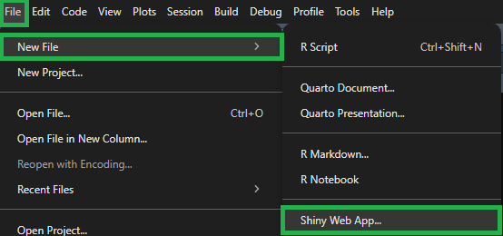
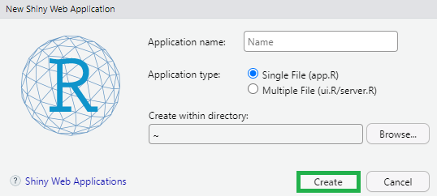
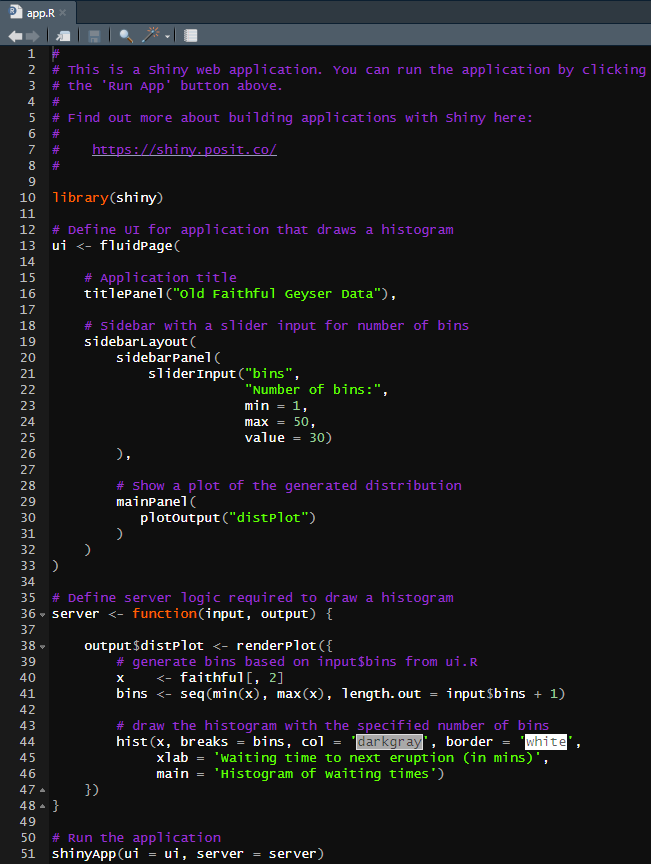
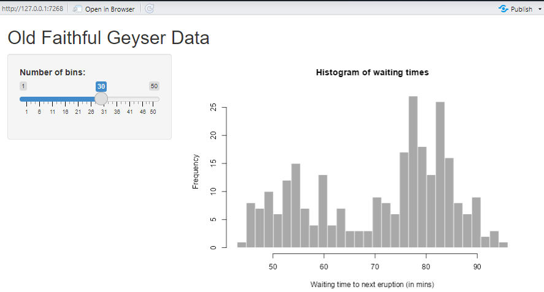
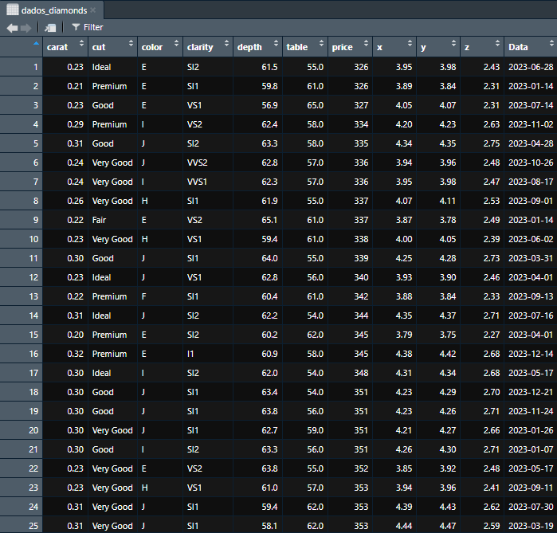

<style>
.sidebar-footer {
  position: fixed;
  bottom: 10px;
  left: 10px;
  font-size: 0.9em;
  color: #555;
}
</style>

<div class="sidebar-footer">
  <strong>Orientador:</strong> Guilherme Veloso
</div>

<style>
/* Container principal - centraliza tudo */
.title-container {
  text-align: center;
  margin: 0 auto 30px auto;
  width: 100%;
  max-width: 900px;
}

/* Título */
h1.title {
  color: #2c3e50;
  text-align: center !important;
  margin-bottom: 10px !important;
  padding-bottom: 10px;
  border-bottom: 2px solid #3498db;
}

p {
  text-align: justify;
}

/* Autor */
.author {
  display: block;
  text-align: center !important;
  font-style: italic;
  color: #7f8c8d;
  margin-bottom: 5px !important;
}

/* Data */
.date {
  display: block;
  text-align: center !important;
}
</style>


```{r , echo=FALSE}
library(knitr)
```

# **Introdução ao Shiny**

{fig-align="center" width="40%"}

O **Shiny** é um pacote do R que permite transformar uma análise de dados em uma aplicação web interativa. Normalmente, quando a gente analisa dados em R, o resultado fica preso no código: um gráfico no **RStudio**, uma tabela no console, um relatório em HTML ou PDF. Quem recebe esse material consegue ler, mas não consegue explorar. O **Shiny** muda isso, porque coloca botões, filtros e controles na frente do usuário e, a partir do que ele escolhe, os resultados se atualizam na hora. Em vez de entregar uma análise pronta, você entrega uma ferramenta que a pessoa pode usar por conta própria, sem precisar saber programar.

O ponto mais interessante é que tudo isso é feito só com R. Você não precisa dominar HTML, CSS ou JavaScript para construir uma página web funcional. O **Shiny** gera essa parte por baixo dos panos, e você se concentra no que já conhece: os dados, as análises e os gráficos. Por isso, ele é tão popular entre estatísticos, cientistas de dados e analistas, que conseguem sair de um *script* de análise para um *dashboard* completo usando as mesmas ferramentas do dia a dia, como o `dplyr` para manipular os dados e o `ggplot2` para os gráficos.

Toda aplicação **Shiny** é construída em torno de duas partes. A primeira é a interface, chamada de `ui`(User Interface), que define o que o usuário vê: o *layout* da página, os filtros, os gráficos e as tabelas. A segunda é o servidor, chamado de `server`, que define o que o aplicativo faz: é onde ficam os cálculos, os filtros dos dados e a criação dos gráficos. O que conecta as duas partes é um conceito chamado **reatividade**. Quando o usuário muda um filtro, o **Shiny** percebe a mudança e refaz automaticamente apenas o que depende dela. Você não precisa escrever "quando clicar, atualize o gráfico": basta dizer que o gráfico depende daquele filtro, e o **Shiny** cuida do resto.

Por fim, o **Shiny** não termina no seu computador. Depois de pronto, o aplicativo pode ser publicado na internet — por exemplo, no **Posit Connect Cloud**, a nova plataforma na nuvem da Posit que está substituindo o antigo `shinyapps.io` — e qualquer pessoa passa a acessá-lo por um *link*, sem instalar nada. É por isso que ele é usado em tantos contextos: *dashboards* de acompanhamento de negócio, ferramentas de exploração de dados, protótipos e até aplicações de pesquisa. Ao longo deste *workshop*, a ideia é justamente essa: sair do zero e construir, passo a passo, um *dashboard* interativo, entendendo cada função que o faz funcionar.

## A Historia do Shiny

O **Shiny** nasceu por volta de 2012, criado por Joe Cheng na **RStudio** (hoje **Posit**), para resolver um problema da comunidade: o R era ótimo para analisar dados, mas transformar uma análise numa ferramenta interativa exigia aprender várias outras tecnologias da web. A proposta foi permitir que o próprio analista fizesse isso, usando apenas R.

Desde então, o **Shiny** cresceu junto com a comunidade: surgiram formas simples de publicar *apps* na internet, pacotes para deixar o visual mais moderno e um livro gratuito, o *Mastering Shiny*, que virou referência de aprendizado. Em 2022, ele chegou também ao **Python**, e hoje é uma das ferramentas mais usadas para criar aplicações de dados.

## Iniciando o Shiny

O **Shiny**, por ser um pacote, não vem integrado nem à linguagem R e nem à IDE utilizada (**RStudio**, **VS Code**, entre outras), além de ter de ser ativado toda a vez que inicializar o *script*.

``` r
install.packages("shiny")
library(shiny)
```

Existem algumas maneiras de inicializar um Shiny Pelo RStudio (o mais prático):

1.  Vá em File \> New File \> Shiny Web App...
2.  Dê um nome e escolha onde salvar
3.  Escolha Single File (app.R)

{fig-align="left" width="50%"}{fig-align="right" width="45%"}

Desse jeito irá criar uma pasta no seu diretório com o nome que você colocou, e criará dentro da pasta um script nomeado "app" com a extensão R, esse script é um modelo inicial que já introduz a funcionalidade de um shiny, plotando um histograma que nos possibillita interagir

{fig-align="center" width="50%"}

Pra compilar um aplicativo de Shiny você pode rodar toda estrutura do modelo ou clickar diretamente em **run app**

{fig-align="center" width="50%"}

Uma janela ligada ao **R** irá abrir com o Dashboard já com a interatividade. 

{fig-align="right" width="67%"}

Você pode iniciar um Dashboard Shiny diretamente em um script comum, porém por ter uma estrutura organizada a ser seguida, construir diretamente do zero pode não ser a melhor opção.

# **Construção do Dashboard**

Construir um *dashboard* em **Shiny** começa bem antes de escrever a interface: começa pelos dados e por uma pergunta simples, que é: ["o que a pessoa que vai usar precisa enxergar?"]{.underline}. A partir daí, o caminho é sempre parecido. **Primeiro**, carregamos e preparamos os dados no topo do *script*, [uma única vez]{.underline}, para o aplicativo não repetir esse trabalho a cada interação. **Depois**, desenhamos o esqueleto da página: uma **barra lateral** para os filtros, uma **área principal** com os indicadores no topo, os gráficos no meio e uma tabela com os dados no final.

Com o esqueleto pronto, a atenção se volta para o que colocar em cada espaço, e é aqui que um *dashboard* se torna inteligente. A regra principal é que [cada elemento da tela deve responder a uma pergunta]{.underline} e, se não responde a nenhuma, **deve sair**. Por isso, os **indicadores mais importantes** ficam no topo, para que a pessoa tenha a resposta principal em poucos segundos, e os detalhes vêm depois, em ordem de importância. [Cada gráfico deve passar uma única mensagem]{.underline}, e a escolha do tipo importa: **linhas** para mostrar evolução no tempo, **barras** para comparar categorias e **dispersão** para relacionar duas variáveis. Também vale resistir à tentação de colocar tudo na tela: [poucos filtros, bem escolhidos]{.underline}, ajudam mais do que dezenas de opções. Por fim, a **consistência** faz a diferença: mantenha as mesmas cores para as mesmas categorias, títulos claros e rótulos com unidades, para que o usuário entenda o *dashboard* sem precisar de explicação.

O passo final é a **interatividade**, que transforma o *dashboard* em uma [ferramenta de exploração]{.underline}. Os filtros devem se conectar a todos os elementos da tela, de modo que [uma única escolha atualize indicadores, gráficos e tabela ao mesmo tempo]{.underline}, mantendo tudo consistente. Recursos extras, como **restaurar os filtros** ou **baixar os dados filtrados**, completam a experiência. O resultado é um **painel que o usuário consegue usar sozinho**, e é isso que vamos construir juntos nos próximos capítulos.

# **Interface e estrutura de um Shiny**

## Passo 1: pacotes e dados

Todo script começa carregando os pacotes que vamos usar. A função `library()` carrega um pacote já instalado: **instala-se uma vez, carrega-se toda vez**. Neste app usamos apenas três: `shiny` (o framework), `ggplot2` (gráficos) e `dplyr` (manipulação de dados).


``` r
library(shiny)
library(ggplot2)
library(dplyr)

set.seed(123)

dados_diamonds <- diamonds |>
  mutate(
    Data = sample(
      seq.Date(as.Date("2023-01-01"), as.Date("2023-12-31"), by = "day"),
      size = n(),
      replace = TRUE
    )
  )
```

-   `set.seed()` trava o sorteio, para que as datas sejam sempre as mesmas.
-   `mutate()` cria uma coluna nova na tabela.
-   `seq.Date()` gera todos os dias de 2023, e `sample()` sorteia uma data para cada diamante.
-   `n()` é o número de linhas da tabela.

::: callout-tip
Os dados ficam **fora** da interface e do servidor, no topo do script. Assim são carregados uma única vez, e não a cada interação do usuário.
:::

Para conferir, selecione o trecho, execute com `Ctrl + Enter` e digite `head(dados_diamonds)` no console. A coluna `Data` deve aparecer.

### Sobre a Base

Para construir o *dashboard* deste *workshop*, utilizaremos a base `dados_diamonds`, uma adaptação do clássico conjunto de dados `diamonds` (nativo do pacote `ggplot2`), enriquecida com uma dimensão temporal artificial. Ao todo, ela reúne **53.940 observações** (cada linha representa um diamante) e **11 variáveis** — as 10 originais somadas à coluna `Data`.

Por combinar variáveis numéricas contínuas, categóricas ordinais e datas, essa base é ideal para explorar os principais tipos de filtros do **Shiny**, como `sliderInput()`, `selectInput()` e `dateRangeInput()`.

::: {.callout-tip title="Reprodutibilidade"}
Como a coluna `Data` é criada com a função `sample()`, as datas seriam sorteadas de forma diferente a cada execução do *script*. O uso de `set.seed(123)` garante que todos tenham exatamente a mesma base e os mesmos gráficos temporais.
:::

### Dicionário de Variáveis

| Variável | Tipo | Descrição |
| :--- | :--- | :--- |
| `price` | Numérica (inteiro) | Preço do diamante em dólares americanos (US$) |
| `carat` | Numérica (contínua) | Peso do diamante em quilates |
| `cut` | Categórica (ordinal) | Qualidade do corte(*Fair*, *Good*, *Very Good*, *Premium* e *Ideal*). |
| `color` | Categórica (ordinal) | Cor do diamante |
| `clarity` | Categórica (ordinal) | Categorização de Pureza (*I1*, *SI2*, *SI1*, *VS2*, *VS1*, *VVS2*, *VVS1* e *IF*). |
| `x` | Numérica (contínua) | Comprimento do diamante em milímetros |
| `y` | Numérica (contínua) | Largura do diamante em milímetros |
| `z` | Numérica (contínua) | Profundidade do diamante em milímetros |
| `depth` | Numérica (contínua) | Percentual de profundidade total |
| `table` | Numérica (contínua) | Largura do topo do diamante  |
| `Data` | Data (`Date`) | Data fictícia sorteada aleatoriamente entre `2023-01-01` e `2023-12-31` | 

____________________________________________________________________________________________________________________________________

{fig-align="center" width="67%"}


## Passo 2: o esqueleto do app

Todo app Shiny tem três peças: a **interface** (`ui`), o **servidor** (`server`) e a chamada `shinyApp()` que junta as duas. Vamos criar a versão mais simples possível, com uma barra de navegação e uma aba vazia.

``` r
ui <- navbarPage(
  title = "Um Brilhante jeito de fazer Dashboards no R: Shiny",

  tabPanel(
    title = "1. Inputs e Tabelas",
    "Em construção..."
  )
)

server <- function(input, output, session) {

}

shinyApp(ui = ui, server = server)
```

-   `navbarPage()` cria a página com uma barra de abas no topo.
-   `tabPanel()` cria cada aba.
-   O `server` é uma função com três argumentos: `input` (o que o usuário escolhe), `output` (o que o app entrega) e `session` (dados da sessão).
-   `shinyApp()` junta tudo e inicia o aplicativo.

Clique em **Run App**. Deve aparecer a barra de navegação com uma aba vazia. Para encerrar o app, clique no botão **Stop**.

## Passo 3: o layout da aba

Agora dividimos a aba em duas áreas: uma barra lateral, para os controles, e uma área principal, para os resultados.

Substitua o texto `"Em construção..."` por:

``` r
    sidebarLayout(
      sidebarPanel(
        h3("Controles")
      ),
      mainPanel(
        h3("Resultados")
      )
    )
```

-   `sidebarLayout()` divide a aba em duas áreas.
-   `sidebarPanel()` é a coluna lateral.
-   `mainPanel()` é a área maior.
-   `h3()` cria um título.

Execute novamente. A aba agora tem a lateral e a área principal.

## Passo 4: o primeiro input e o primeiro output

Este é o passo em que o app ganha vida. Vamos criar um **input** (um controle para o usuário) e um **output** (um espaço para o resultado) e ligar os dois.

Dentro do `sidebarPanel()`, depois do `h3("Controles")`, acrescente uma vírgula e o input:

``` r
        radioButtons(
          inputId  = "corte_select",
          label    = "Qualidade do corte (cut):",
          choices  = c("Todos", levels(dados_diamonds$cut)),
          selected = "Ideal"
        )
```

Dentro do `mainPanel()`, depois do `h3("Resultados")`, acrescente uma vírgula e o output:

``` r
        textOutput(outputId = "resumo_texto")
```

E dentro do `server`, preencha esse espaço:

``` r
  output$resumo_texto <- renderText({
    paste("Corte selecionado:", input$corte_select)
  })
```

-   `radioButtons()` cria uma lista de opções em que só uma pode ser escolhida.
-   O `inputId` é o nome pelo qual o servidor lê o valor: `input$corte_select`.
-   `levels()` lista as categorias de corte do conjunto de dados.
-   `textOutput()` reserva um espaço para um texto na tela.
-   `renderText()` produz o texto que vai para esse espaço.

Execute e clique nas opções: o texto muda sozinho. **Isso é a reatividade.**

::: callout-important
O nome em `output$resumo_texto` precisa ser **idêntico** ao `outputId` da interface. É por esse nome que o Shiny sabe qual resultado vai em qual lugar.
:::

## Passo 5: um filtro reutilizável com `reactive()`

Vamos precisar dos dados filtrados por corte em vários lugares: texto, tabela, sumário, gráfico e download. Em vez de repetir o filtro cinco vezes, criamos **um único** e reaproveitamos. Isso é feito com `reactive()`.

No `server`, antes do `output$resumo_texto`, acrescente:

``` r
  dados_corte <- reactive({
    req(input$corte_select)

    if (input$corte_select == "Todos") {
      dados_diamonds
    } else {
      dados_diamonds |> filter(cut == input$corte_select)
    }
  })
```

E troque o `renderText` por uma versão que usa esse filtro:

``` r
  output$resumo_texto <- renderText({
    paste(
      "Exibindo", format(nrow(dados_corte()), big.mark = "."),
      "registros para o corte:", input$corte_select
    )
  })
```

-   `reactive()` cria um valor calculado que se atualiza sempre que os inputs dos quais depende mudam.
-   `filter()` seleciona as linhas que atendem a uma condição.
-   `req()` espera o input ter valor antes de continuar, evitando erros na tela.
-   `nrow()` conta as linhas da tabela.

::: callout-warning
Um `reactive()` é usado **como uma função**, com parênteses: `dados_corte()`. Escrever `dados_corte` sem os parênteses é o erro mais comum de quem está começando.
:::

Execute: a contagem de registros muda conforme o corte escolhido.

## Passo 6: a tabela

Agora mostramos uma prévia dos dados filtrados e deixamos o usuário escolher quantas linhas quer ver.

Na barra lateral, depois do `radioButtons()`, acrescente uma vírgula e:

``` r
        hr(),

        numericInput(
          inputId = "qtd_linhas",
          label   = "Linhas na tabela:",
          value = 5, min = 1, max = 20, step = 1
        )
```

Na área principal, depois do `textOutput()`, acrescente uma vírgula e:

``` r
        br(),

        h4("Prévia dos dados filtrados"),
        tableOutput(outputId = "tabela_diamonds")
```

No `server`:

``` r
  output$tabela_diamonds <- renderTable({
    req(input$qtd_linhas)

    dados_corte() |>
      select(carat, cut, color, clarity, price, Data) |>
      slice_head(n = input$qtd_linhas)
  })
```

-   `numericInput()` cria uma caixa para digitar um número, com limites mínimo e máximo.
-   `tableOutput()` e `renderTable()` formam o par da tabela.
-   `select()` escolhe as colunas e `slice_head()` pega as primeiras linhas.
-   `hr()` desenha uma linha separadora e `br()` insere um espaço vertical.

Execute e mude o corte e a quantidade de linhas. Duas entradas diferentes alimentam a mesma tabela.

## Passo 7: o sumário estatístico

Para mostrar a saída do `summary()` exatamente como aparece no console, usamos um par de funções próprio para texto de console.

Na área principal, depois da tabela, acrescente uma vírgula e:

``` r
        hr(),

        h4("Sumário estatístico"),
        verbatimTextOutput(outputId = "summary_dados")
```

No `server`:

``` r
  output$summary_dados <- renderPrint({
    dados_corte() |>
      select(carat, price) |>
      summary()
  })
```

-   `verbatimTextOutput()` reserva um espaço em fonte monoespaçada, que respeita espaços e quebras de linha.
-   `renderPrint()` captura o que seria impresso no console.
-   `summary()` calcula mínimo, quartis, mediana, média e máximo.

Repare que o `dados_corte()` já alimenta três saídas diferentes. Esse é o ganho do `reactive()`.

## Passo 8: o gráfico

Agora um histograma do preço, com a cor escolhida pelo usuário.

Na barra lateral, depois do `numericInput()`, acrescente uma vírgula e:

``` r
        hr(),

        selectInput(
          inputId  = "cor_grafico",
          label    = "Cor do gráfico:",
          choices  = c("Azul" = "steelblue", "Vermelho" = "firebrick", "Verde" = "forestgreen"),
          selected = "steelblue"
        )
```

Na área principal, depois do sumário, acrescente uma vírgula e:

``` r
        hr(),

        h4("Distribuição do preço"),
        plotOutput(outputId = "histograma_preco", height = "300px")
```

No `server`:

``` r
  output$histograma_preco <- renderPlot({
    ggplot(dados_corte(), aes(x = price)) +
      geom_histogram(bins = 30, fill = input$cor_grafico, color = "white") +
      labs(x = "Preço (US$)", y = "Quantidade de diamantes") +
      theme_minimal(base_size = 14)
  })
```

-   `selectInput()` cria uma lista suspensa. O usuário vê o nome ("Azul") e o servidor recebe o valor ("steelblue").
-   `plotOutput()` e `renderPlot()` formam o par do gráfico.
-   `ggplot()` inicia o gráfico e `aes()` indica qual variável vai em cada eixo.
-   `geom_histogram()` desenha as barras, `labs()` nomeia os eixos e `theme_minimal()` deixa o visual limpo.

Execute e troque o corte e a cor.

## Passo 9: baixar os dados filtrados

Por fim, um botão para o usuário levar embora exatamente o recorte que está vendo.

Na barra lateral, depois do `selectInput()`, acrescente uma vírgula e:

``` r
        hr(),

        downloadButton(outputId = "download_dados", label = "Baixar CSV filtrado")
```

No `server`:

``` r
  output$download_dados <- downloadHandler(
    filename = function() {
      paste0("diamonds_filtrados_", Sys.Date(), ".csv")
    },
    content = function(file) {
      write.csv(dados_corte(), file, row.names = FALSE)
    }
  )
```

-   `downloadButton()` apenas desenha o botão.
-   `downloadHandler()` entrega o arquivo. Ele recebe duas funções: `filename`, que define o nome, e `content`, que escreve o conteúdo.
-   `Sys.Date()` devolve a data de hoje, usada para carimbar o nome do arquivo.
-   `write.csv()` grava a tabela em formato CSV.

Filtre, baixe e abra o arquivo: ele contém apenas os dados do corte escolhido.

## Passo 10: uma segunda aba, com filtro de datas

Vamos criar uma nova aba com um gráfico filtrado por período. Uma nova aba é um novo `tabPanel()`.

Na `ui`, depois do fechamento do primeiro `tabPanel(...)`, coloque uma vírgula e acrescente:

``` r
  tabPanel(
    title = "2. Boxplot e Botão de Ação",
    sidebarLayout(
      sidebarPanel(
        h3("Filtro de tempo"),

        dateRangeInput(
          inputId   = "intervalo_datas",
          label     = "Data da compra:",
          start     = "2023-01-01",
          end       = "2023-06-30",
          min       = "2023-01-01",
          max       = "2023-12-31",
          format    = "dd/mm/yyyy",
          language  = "pt-BR",
          separator = " até "
        )
      ),

      mainPanel(
        h3("Preço por cor do diamante"),
        plotOutput(outputId = "boxplot_diamonds", height = "450px")
      )
    )
  )
```

No `server`, acrescente o filtro de datas e o gráfico:

``` r
  dados_tempo <- reactive({
    req(input$intervalo_datas)

    dados_diamonds |>
      filter(
        Data >= input$intervalo_datas[1],
        Data <= input$intervalo_datas[2]
      )
  })

  output$boxplot_diamonds <- renderPlot({
    df <- dados_tempo()
    req(nrow(df) > 0)

    ggplot(df, aes(x = color, y = price, fill = color)) +
      geom_boxplot(alpha = 0.7, outlier.alpha = 0.2) +
      scale_y_log10(
        labels = function(x) paste0("$", format(x, scientific = FALSE, trim = TRUE, big.mark = ","))
      ) +
      labs(
        title    = "Distribuição do preço por cor (escala log)",
        subtitle = paste(
          "Período:", format(min(df$Data), "%d/%m/%Y"),
          "até", format(max(df$Data), "%d/%m/%Y")
        ),
        x = "Cor do diamante (D = melhor, J = pior)",
        y = "Preço (US$)"
      ) +
      theme_minimal(base_size = 14) +
      theme(legend.position = "none")
  })
```

-   `dateRangeInput()` cria um seletor de intervalo de datas. O servidor recebe duas datas: `input$intervalo_datas[1]` (início) e `input$intervalo_datas[2]` (fim).
-   `geom_boxplot()` desenha o boxplot, que mostra a mediana, os quartis e os valores atípicos.
-   `scale_y_log10()` usa escala logarítmica no eixo do preço, porque os valores são muito assimétricos.
-   `format()` converte a data para texto no padrão brasileiro (`dia/mês/ano`).

Execute e mude as datas. O gráfico se atualiza **a cada alteração**, que é o comportamento padrão do Shiny.

## Passo 11: controlando quando atualizar, com `eventReactive()`

Nem sempre queremos que tudo reaja a cada mudança. Quando o usuário precisa ajustar vários filtros antes de ver o resultado, ou quando o cálculo é pesado, é melhor esperar um comando. Para isso usamos um botão de ação e o `eventReactive()`.

Na aba 2, dentro do `sidebarPanel()`, depois do `dateRangeInput()`, acrescente uma vírgula e:

``` r
        hr(),

        p("O Shiny atualiza sozinho. O botão trava a atualização até o usuário clicar:"),
        actionButton(
          inputId = "btn_atualizar",
          label   = "Aplicar filtro"
        )
```

No `server`, troque a primeira linha de `dados_tempo` e deixe o resto do bloco igual:

``` r
  dados_tempo <- eventReactive(input$btn_atualizar, ignoreNULL = FALSE, {
    req(input$intervalo_datas)

    dados_diamonds |>
      filter(
        Data >= input$intervalo_datas[1],
        Data <= input$intervalo_datas[2]
      )
  })
```

-   `actionButton()` cria um botão cujo valor é um contador de cliques.
-   `eventReactive()` funciona como o `reactive()`, mas só recalcula quando o evento indicado acontece (aqui, o clique no botão).
-   `ignoreNULL = FALSE` faz o cálculo rodar também na abertura do app, para o gráfico não começar vazio.

Execute e mude as datas: nada acontece. Clique em **Aplicar filtro** e o gráfico se atualiza.

| Função | Quando reage | Para quê |
|--------------------|-----------------------|-----------------------------|
| `reactive()` | a **qualquer** mudança dos inputs que usa | calcular um valor reutilizável |
| `eventReactive()` | só a **um evento** (como um clique) | calcular um valor sob comando |

## O mapa mental do app

Tudo o que construímos segue o mesmo caminho:

``` text
 input$  -->  reactive()  -->  render*()  -->  output$
(usuário)    (calcula)        (desenha)       (tela)
```

O usuário mexe em um **input**, o servidor calcula com `reactive()`, desenha com uma função `render*()` e o resultado aparece em um **output**.

## Resumo das funções do app

| Componente | Função da interface | Função do servidor | Finalidade |
|------------------|------------------|------------------|------------------|
| Navegação | `navbarPage()`, `tabPanel()` | n/a | Barra superior e abas |
| Layout | `sidebarLayout()`, `sidebarPanel()`, `mainPanel()` | n/a | Lateral e área principal |
| Opções | `radioButtons()` | `input$id` | Escolha única |
| Número | `numericInput()` | `input$id` | Valor digitado |
| Lista | `selectInput()` | `input$id` | Lista suspensa |
| Datas | `dateRangeInput()` | `input$id` | Intervalo de datas |
| Botão | `actionButton()` | `eventReactive()` | Controla quando recalcular |
| Texto | `textOutput()` | `renderText()` | Texto simples |
| Tabela | `tableOutput()` | `renderTable()` | Tabela estática |
| Console | `verbatimTextOutput()` | `renderPrint()` | Saída como `summary()` |
| Gráfico | `plotOutput()` | `renderPlot()` | Gráfico do ggplot2 |
| Download | `downloadButton()` | `downloadHandler()` | Baixar arquivo |
| Filtro compartilhado | n/a | `reactive()` | Cálculo reutilizável |
| Proteção | n/a | `req()` | Evita erros com valor vazio |

## Erros comuns

-   O nome do `output$` é diferente do `outputId` da interface.
-   Usar `dados_corte` em vez de `dados_corte()`.
-   Esquecer a **vírgula** entre os elementos da interface. Quando o app não abre, o console indica a linha com o problema.
-   Carregar os dados dentro do `server`, em vez de no topo do script.

# **Interatividade e comando de ações**

A **interatividade** do **Shiny** funciona como uma [conversa em três tempos]{.underline}: o **usuário** mexe em um controle, o **servidor** recalcula, e o **resultado** aparece atualizado na tela. O ponto que muita gente não percebe é que [você não precisa programar o "quando atualizar"]{.underline}. Basta dizer que um resultado depende de um controle, e o **Shiny** cuida do resto, refazendo automaticamente tudo o que depende do valor que mudou. É essa lógica que faz um filtro alterar, ao mesmo tempo, os **indicadores**, o **gráfico** e a **tabela**.

O que conecta cada controle ao seu resultado é o **nome**. Todo *input* recebe um identificador, o `inputId`, e esse nome vira o endereço do valor no servidor: se o controle se chama `"especie"`, o que o usuário escolheu chega como `input$especie`. Com os resultados é a mesma ideia, só que no sentido contrário: o espaço reservado na interface, como um `plotOutput("grafico")`, é preenchido no servidor por `output$grafico`. Nos dois casos, [o nome precisa ser idêntico dos dois lados]{.underline}. Se uma letra estiver diferente, o **Shiny** não encontra o par, e o controle ou o resultado simplesmente não funciona. Por isso, quando algo não responde, [o primeiro lugar para olhar é a grafia dos nomes]{.underline}.

O que muda de um controle para outro é o **tipo de escolha** que ele oferece, e isso deve guiar a decisão de quem monta o *dashboard*. Para escolher [uma única opção]{.underline}, usamos botões de seleção única ou uma lista suspensa, como `radioButtons()` e `selectInput()`. Para escolher [várias opções ao mesmo tempo]{.underline}, usamos caixas de marcação, como `checkboxGroupInput()`. Para [valores numéricos]{.underline}, a barra deslizante, `sliderInput()`, permite escolher um número ou, com dois pontos, um intervalo, e `numericInput()` serve para quem prefere digitar. Para [datas]{.underline}, há o `dateRangeInput()`, e para [disparar uma ação sob comando do usuário]{.underline}, o `actionButton()`. O dado que chega ao servidor muda conforme o controle (um texto, vários textos, um número, um par de valores ou uma data), mas o caminho é sempre o mesmo: [o nome liga o controle ao servidor, e o servidor entrega o resultado no *output*]{.underline}.

## Dicas e Boas práticas

Depois que o *dashboard* funciona, o próximo passo é deixá-lo **bonito e robusto**, e o pacote `bslib` é o [caminho mais simples para isso]{.underline}. Com ele, o visual do *app* inteiro é definido em um único lugar: basta usar a função `bs_theme()` no argumento `theme` da página, escolhendo um tema pronto, como `bootswatch = "flatly"` (você pode descobrir opções de temas no site da [bootswatch](https://bootswatch.com)), e a cor principal com `primary = "#678be0"`. Funções como `page_sidebar()`, `card()` e `value_box()` já aproveitam o tema, e o *dashboard* ganha uma aparência moderna com poucas linhas. Uma dica útil é rodar `bs_themer()` dentro do `server` durante o desenvolvimento, o que abre um [painel interativo para testar cores e temas ao vivo]{.underline}:

```r
library(bslib)
```

```r
  theme = bs_theme(
    bootswatch = "flatly",
    primary = "#678be0"
  ),
```

O **Shiny** também se integra com facilidade a outros pacotes, quase sempre seguindo o mesmo padrão que já conhecemos: uma função `*Output()` na interface e uma `render*()` no servidor. O `DT` transforma tabelas comuns em [tabelas interativas]{.underline}, com busca, ordenação e paginação. O `plotly` deixa os gráficos do `ggplot2` interativos, com *zoom* e informações ao passar o *mouse*, e o `leaflet` cria [mapas interativos]{.underline}. Já o `shinydashboard` oferece um *layout* clássico de *dashboard*, com menu lateral e caixas de indicadores, embora o `bslib` seja hoje o **caminho mais atual** para projetos novos.

Carregue os dados [uma única vez, no topo do *script*]{.underline}, e para bases grandes prefira formatos como `.rds` ou `.parquet`, que são mais rápidos que o CSV. Dê **nomes claros** aos identificadores, reaproveite cálculos com `reactive()` e use `req()` para [evitar erros na tela]{.underline}. Mantenha o projeto organizado em pastas, use **caminhos relativos** para os arquivos e [nunca deixe senhas ou chaves de acesso dentro do código]{.underline}.

**Tenha um modelo inicial!** Não comece um **Shiny** novo toda vez que for fazer uma aplicação web.

# **Publicação**

Um *dashboard* que só funciona no seu computador ajuda muito pouco. A graça do **Shiny** é que qualquer pessoa possa abrir o seu trabalho por um *link*, sem instalar R e sem rodar código. Publicar é o passo que transforma o projeto em uma ferramenta de verdade.

Existem várias formas de publicar. O **Posit Connect Cloud** (a plataforma na nuvem que substituiu o `shinyapps.io`) tem plano gratuito e é o jeito mais moderno e simples de começar. O **Posit Connect** tradicional é a opção corporativa, mais usada dentro de empresas. O **Shiny Server** permite hospedar em um servidor próprio, e o **Docker** é usado quando a equipe quer controlar toda a infraestrutura. Vamos usar o **Posit Connect Cloud**.

Antes de publicar, vale conferir quatro coisas no seu código:

1. Se o *app* roda sozinho em uma sessão limpa do R.
2. Se todos os pacotes usados estão devidamente carregados com `library()`.
3. Se os caminhos de arquivos são relativos (porque o caminho `"C:/MeuComputador/..."` não existe no servidor).
4. Se não há dados sensíveis na pasta do projeto, já que tudo o que está nela é enviado.

Agora, o passo a passo. O primeiro passo é criar uma conta gratuita no **Posit Connect Cloud** (cloud.posit.co). Pode ser com e-mail, Google ou GitHub. Ao entrar, você terá acesso ao seu espaço de trabalho (*workspace*).

O segundo passo é instalar o pacote responsável pela publicação, o `rsconnect`, rodando `install.packages("rsconnect")`. Ele é quem faz a ponte entre o seu **RStudio** e o servidor.

O terceiro passo é conectar o seu computador à sua conta, você pode colocar no console a funçao:
```r
rsconnect::connectCloudUser() 
```
Abrirá no navegador uma aba no site da Posit concedendo um código de acesso para conecção da sua conta, após isso é só postar o aplicativo web colocando a função `deployApp()` com o nome da pasta em que está o Shiny
```r
rsconnect::deployApp(appDir = "Shiny")
```

Depois de publicado, você terá um *link* oficial e seguro que pode compartilhar com qualquer pessoa. Se precisar corrigir ou melhorar algo, basta alterar o código e publicar de novo clicando no botão (ou rodando `rsconnect::deployApp()`), que o *app* existente é atualizado sem mudar o *link*.

# **CONCLUSÃO**

Chegando ao fim, vale voltar à pergunta do começo: por que usar o Shiny? Porque ele resolve o último quilômetro da análise de dados. Fazer uma boa análise em R é só metade do trabalho; a outra metade é fazer com que as pessoas certas consigam usar o resultado. Com o Shiny, tudo acontece dentro do R, então você reaproveita o que já sabe, como dplyr, ggplot2 e seus modelos, sem aprender outra linguagem nem depender de uma equipe de desenvolvimento. O usuário ganha autonomia para filtrar e explorar por conta própria, você ganha tempo, e o dashboard publicado fica disponível por um simples link, gratuito e de código aberto, para quantas pessoas precisarem.

** Prós e contras, relação com power BI, limitação de dados **

Na prática do trabalho, as aplicações são muitas. Um time **comercial** acompanha vendas e metas, filtrando por região, período e produto. Uma equipe de **operações** monitora indicadores de qualidade e logística e identifica gargalos. Na **saúde**, dá para acompanhar casos e indicadores por município. Na **pesquisa**, o **Shiny** permite que qualquer pessoa explore os resultados de um estudo. E há dois usos que aparecem o tempo todo: o **protótipo rápido**, para validar uma ideia em poucas horas antes de investir em um sistema grande, e a **ferramenta interna de apoio**, aquela calculadora ou validador de dados que a equipe usa todo dia no lugar de planilhas copiadas.

Se você já sabe fazer análises em R, está a poucos passos de [transformá-las em produtos que outras pessoas usam]{.underline}. Vocês **saem** daqui com o caminho completo: a estrutura de `ui` e `server`, o *layout*, a **reatividade** que dá vida ao *dashboard* e a **publicação**. O próximo passo é [escolher uma análise sua, de um projeto real, e transformá-la em um *app*]{.underline}.

O **Shiny** tem seu próprio [site](https://shiny.posit.co), que apresenta a biblioteca, além de oferecer um pequeno tutorial.
